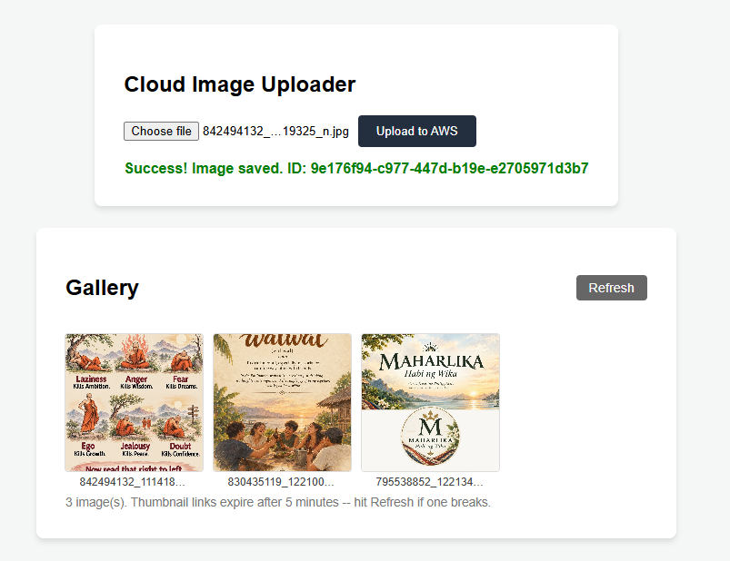

# Serverless Image Upload API

Upload an image from a web page and browse everything uploaded so far. Images are
stored in a private S3 bucket, metadata in DynamoDB. Everything is created with Terraform.

**Stack:** S3 (static site + image storage), API Gateway (REST), Lambda (Node.js 22,
one function per route), DynamoDB (on-demand), IAM, CloudWatch Logs, Terraform.

See [docs/architecture.md](docs/architecture.md) for the diagram.

## Demo



Deployed and tested with Terraform, then destroyed to avoid charges; redeploy with one `terraform apply`.

| Proof | What it shows |
|-------|---------------|
| [Deploy](docs/proof/01-terraform-apply-complete.png) | `terraform apply` completes and prints the outputs (IDs redacted) |
| [XSS fix](docs/proof/03-xss-filename-safe.png) | A file named `x" onload="alert(1)` renders as plain text, no popup |
| [Fake PNG rejected](docs/proof/04-curl-fake-png-rejected.png) | A text file declared as `image/png` is rejected by the magic-byte check |
| [Teardown](docs/proof/05-terraform-destroy-complete.png) | `terraform destroy` removes all 32 resources |

## Project layout

```
terraform/   main.tf, variables.tf, outputs.tf, provider.tf
lambda/      uploadimage.js       (POST /upload, zipped by Terraform)
             listimages.js        (GET /images, zipped by Terraform)
frontend/    index.html.tpl       (template; Terraform injects both API URLs)
docs/        architecture.md, proof/ (screenshots)
```

## How a request flows

**Upload — `POST /upload`**
1. Browser sends `OPTIONS /upload` (CORS preflight). API Gateway answers it with a MOCK integration.
2. Browser sends `POST /upload` with JSON `{ image (base64), fileName, contentType }`.
3. API Gateway invokes `upload_fn` (proxy integration).
4. Lambda validates input (size, allowed type, magic bytes), saves `uploads/<uuid>.<ext>` to S3,
   saves metadata to DynamoDB.
5. Lambda returns `{ message, imageId }` with CORS headers.

**Gallery — `GET /images`**
1. Browser sends `GET /images?limit=24` (a CORS "simple request" — no preflight).
2. API Gateway invokes `list_images_fn` (proxy integration).
3. Lambda `Scan`s the DynamoDB table (up to `limit`, max 50) and, for each item, generates a
   5-minute presigned S3 `GetObject` URL — the images bucket itself is never made public.
4. Lambda returns `{ images: [...], nextCursor }` with CORS headers. `nextCursor` (pass it back
   as `?cursor=`) is `null` once there's nothing left to page through.

## Deploy

Prerequisites: Terraform >= 1.5, AWS CLI configured with a profile (default name `tf-dev`).

```bash
cd terraform
terraform init
terraform apply -var="aws_profile=YOUR_PROFILE"
```

Bucket names are globally unique. If apply fails with `BucketAlreadyExists`, pass your own:
`-var="frontend_bucket_name=..." -var="images_bucket_name=..."`.

Terraform prints four outputs: `frontend_url` (open it in a browser), `api_gateway_url`
(the upload endpoint, already ending in `/upload`), `list_images_url` (the gallery endpoint,
already ending in `/images`), and `images_bucket_name`.

## Test the API

Use the output values as they are; don't append `/upload` or `/images` again.
Run these from the project root, with a small `test.png` in that folder.

**Bash**

```bash
UPLOAD_URL=$(terraform -chdir=terraform output -raw api_gateway_url)
LIST_URL=$(terraform -chdir=terraform output -raw list_images_url)

# Upload (macOS: use `base64 -i test.png` instead of `base64 -w0 test.png`)
B64=$(base64 -w0 test.png)
printf '{"image":"%s","fileName":"test.png","contentType":"image/png"}' "$B64" \
  | curl -X POST "$UPLOAD_URL" -H "Content-Type: application/json" -d @-

# List
curl "$LIST_URL?limit=10"
```

**PowerShell**

```powershell
$url  = terraform -chdir=terraform output -raw api_gateway_url
$list = terraform -chdir=terraform output -raw list_images_url

# Upload
$b64  = [Convert]::ToBase64String([IO.File]::ReadAllBytes("test.png"))
$body = @{ image = $b64; fileName = "test.png"; contentType = "image/png" } | ConvertTo-Json
Invoke-RestMethod -Method Post -Uri $url -ContentType "application/json" -Body $body

# List
Invoke-RestMethod "${list}?limit=10"
```

Then check the S3 bucket for `uploads/...` and the DynamoDB table for the metadata item.

**Negative test:** encode a plain text file as base64 and send it with `contentType` set to
`image/png`. The API returns `400` with `File content does not match the declared contentType`.

## Limits and design choices

- Max image size 4 MB: Lambda accepts 6 MB request payloads and base64 adds about 33%.
- Allowed types: png, jpeg, gif, webp. The file's leading bytes (magic bytes) are checked
  against the declared type, so a renamed text file is rejected. Non-object request bodies
  return `400`. IDs are server-generated UUIDs.
- The gallery builds its DOM with safe DOM APIs, so filenames are always shown as text and
  never interpreted as HTML.
- `GET /images` defaults to 20 results per page (`?limit=`, capped at 50) and pages with an
  opaque `?cursor=` token. It reads with a DynamoDB `Scan`, so pages aren't guaranteed to be
  in upload order and this won't scale past a small table — see docs/architecture.md.
- Presigned image URLs returned by `GET /images` expire after 5 minutes.
- The API is public (no auth) with stage throttling (5 req/s, burst 10). Demo only.

## Cleanup

```bash
cd terraform
terraform destroy -var="aws_profile=YOUR_PROFILE"
```

Cost: at demo scale this sits at or near the AWS free tier (Lambda, API Gateway, DynamoDB
on-demand, small S3 usage), but nothing here should stay running. Run `terraform destroy`
when you're done. The images bucket uses `force_destroy`, so uploaded test images are deleted too.

## Known gaps

- **No authentication:** the API is open to anyone with the URL. Next step: API key or Cognito.
- **Wildcard CORS:** responses allow any origin. Should be restricted to the frontend's origin.
- **Orphaned S3 object:** if the DynamoDB write fails after the S3 upload succeeds, the image
  stays in S3 with no metadata. Fix: clean up on failure, or a periodic reconciliation job.
- **`Scan` instead of `Query`:** a GSI with a constant partition key and `uploadedAt` as the
  sort key would give upload-ordered results that scale.
- **No automated tests yet.**

**Next steps:** presigned-URL uploads for large files, CloudFront + HTTPS for the frontend,
WAF, remote Terraform state, CI/CD with GitHub Actions (OIDC), CloudWatch alarms.
